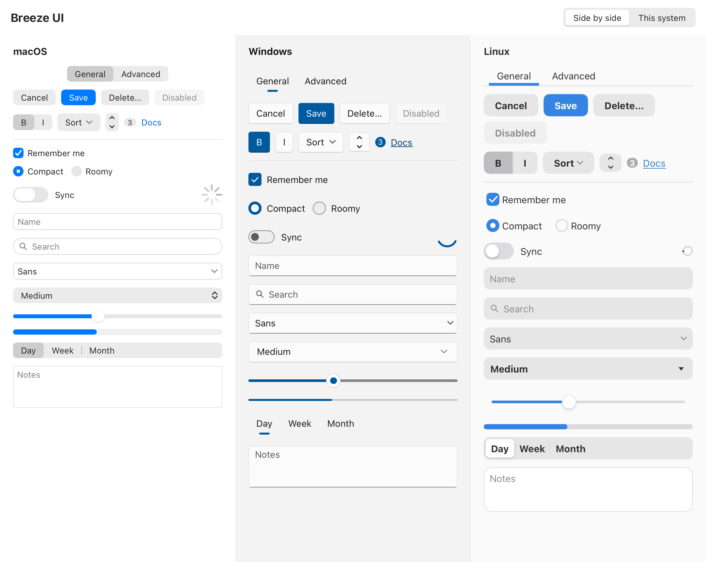

# Breeze UI for MyGo

[](https://github.com/yldm-tech/mygo-breeze-ui/actions/workflows/ci.yml)
[](https://pkg.go.dev/github.com/yldm-tech/mygo-breeze-ui)
[](LICENSE)
[](https://github.com/yldm-tech/mygo-breeze-ui/stargazers)

[Website](https://yldm-tech.github.io/mygo-breeze-ui/) · [English](README.md) · [简体中文](README.zh-CN.md)

Breeze UI draws [MyGo](https://github.com/egoist/mygo)'s native UI widgets as the desktop the app runs on draws its own: macOS's controls on a Mac, Windows 11's on Windows and GNOME's libadwaita controls on Linux. The widgets have the names and signatures of MyGo's package `ui`, so a view swaps `ui.Button` for `breeze.Button` and keeps everything else.



## What is included

- `ui/breeze`: buttons, toggles and toggle groups, check boxes, radio buttons and radio groups, switches, text and search fields, text inputs and areas editing a `ui.TextBuffer`, combo boxes, drop-downs, sliders, steppers, progress bars, spinners, segmented controls, tabs, document tab bars whose tabs close with a button to add one, text in the platform's type ramp (titles, headings, body, captions and dimmed secondary text), links, dividers, badges, menu buttons, popovers, dialogs and alerts, tooltips and toasts, disclosures and accordions, fieldsets and forms, cards, settings rows and switch rows, combo, entry, spin and expander rows, sidebars, breadcrumbs, back and forward buttons and toolbars, header bars for windows whose title bar is hidden, view switchers for an app's top-level views, meters, avatars and ratings, inline message bars, progress rings, empty-state pages, stepped sliders, number inputs, date and time fields, color wells, check box groups, split views, lists, tables, trees, outlines, grids, editable text, autocomplete and token fields, password fields, split buttons and icon buttons drawn as each platform draws them, following macOS 27, WinUI 3 and libadwaita 1.10 (GNOME 51), with sizes and colors measured from AppKit's and libadwaita's own rendering and taken from WinUI 3's theme resources; decimal inputs, range sliders, calendars, color pickers, find bars and scroll containers from package `ui` under the same names, in the platform's theme.
- Themes of the three platforms, light and dark, that follow the accent color, contrast and text size the user chose.
- `breeze-ui`, a CLI that lists the widgets and platforms and writes snippets.
- `breeze-ui-mcp`, a read-only MCP server over the same catalog.

## Go package

```sh
go get github.com/yldm-tech/mygo-breeze-ui
```

```go
import (
    "github.com/egoist/mygo/ui"
    breeze "github.com/yldm-tech/mygo-breeze-ui/ui/breeze"
)

func (app *settings) view(c *ui.Context) {
    breeze.Use(c) // the platform's colors and metrics
    ui.Column(c).Padding(16).Gap(12).Children(func() {
        breeze.Checkbox(c, &app.remember, "Remember me")
        breeze.Switch(c, &app.sync).Label("Sync")
        ui.Row(c).Gap(8).Children(func() {
            breeze.Button(c, "Cancel")
            if breeze.PrimaryButton(c, "Save").Clicked() {
                app.save()
            }
        })
    })
}
```

The platform is the system's unless `breeze.SetPlatform` picks another; `breeze.Preview(c, p, body)` draws part of a window as another platform, as the gallery does:

```sh
go run ./examples/breeze-ui
```

The pointer, the keyboard, the focus and accessibility come from MyGo's widget bases (`ui.ButtonBase`, `ui.CheckboxBase`, `ui.SwitchBase`). [docs/breeze-ui.md](docs/breeze-ui.md) lists what each widget looks like on each platform, where the values come from, and the current limits.

## Storybook

Every widget, on every platform, light and dark, with controls that change its arguments and the Go that builds it: **[the storybook](https://yldm-tech.github.io/mygo-breeze-ui/storybook/)** runs in the browser, compiled to WebAssembly, and the same program opens as a window:

```sh
go run ./examples/storybook
```

## CLI

```sh
npx breeze-ui list
npx breeze-ui add Switch -o ui/switch_snippet.go
```

Or install the Go command:

```sh
go install github.com/yldm-tech/mygo-breeze-ui/cmd/breeze-ui@latest
```

## MCP server

```sh
bun install
bun run build
```

The `breeze-ui-mcp` package exposes read-only tools to search components, list the platforms and generate snippets.

## Development

```sh
go test ./...
go run ./examples/breeze-ui
BREEZE_SCREENSHOTS=/tmp/shots go test ./ui/breeze -run TestScreenshots   # write each platform's controls as PNG
bun install
bun run test
bun run typecheck
bun run build
```

## Star History

[](https://star-history.com/#yldm-tech/mygo-breeze-ui&Date)

## License

[MIT](LICENSE)
