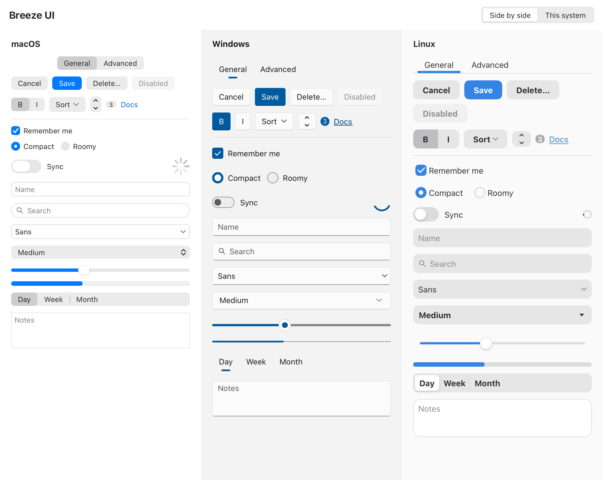

# Breeze UI for MyGo

[](https://github.com/yldm-tech/mygo-breeze-ui/actions/workflows/ci.yml)
[](https://pkg.go.dev/github.com/yldm-tech/mygo-breeze-ui)
[](LICENSE)
[](https://github.com/yldm-tech/mygo-breeze-ui/stargazers)
[](https://x.com/suzukaze_haduki)
[](https://github.com/sponsors/houko)

[官网](https://breeze-ui.yldm.ai/) · [English](README.md) · [简体中文](README.zh-CN.md)

Breeze UI 让 [MyGo](https://github.com/egoist/mygo) 的原生 UI 控件按应用所在的系统绘制：在 Mac 上是 macOS 的控件，在 Windows 上是 Windows 11 的控件，在 Linux 上是 GNOME libadwaita 的控件。控件的名字和签名与 MyGo 的 `ui` 包完全一致，把 `ui.Button` 换成 `breeze.Button` 即可，其余代码不用改。



## 包含内容

- `ui/breeze`：按各平台的样子绘制的控件，对照 macOS 27、WinUI 3 和 libadwaita 1.10（GNOME 51），尺寸和颜色量自 AppKit 与 libadwaita 的实际渲染，或取自 WinUI 3 的主题资源；另有少数控件以同样的名字使用 `ui` 包的控件，配上平台主题。全部控件见[官网目录](https://breeze-ui.yldm.ai/#catalog)，[Storybook](https://breeze-ui.yldm.ai/storybook/) 可以逐个查看，[`docs/widgets`](docs/widgets) 按组介绍。
- 三个平台的浅色和深色主题，跟随用户选择的强调色、对比度和文字大小。
- `breeze-ui` CLI：列出控件和平台，生成代码片段。
- `breeze-ui-mcp`：基于同一份目录的只读 MCP 服务。

## Go 包

```sh
go get github.com/yldm-tech/mygo-breeze-ui
```

```go
import (
    "github.com/egoist/mygo/ui"
    breeze "github.com/yldm-tech/mygo-breeze-ui/ui/breeze"
)

func (app *settings) view(c *ui.Context) {
    breeze.Use(c) // the platform's colors and metrics
    ui.Column(c).Padding(16).Gap(12).Children(func() {
        breeze.Checkbox(c, &app.remember, "Remember me")
        breeze.Switch(c, &app.sync).Label("Sync")
        ui.Row(c).Gap(8).Children(func() {
            breeze.Button(c, "Cancel")
            if breeze.PrimaryButton(c, "Save").Clicked() {
                app.save()
            }
        })
    })
}
```

默认按当前系统选择平台，`breeze.SetPlatform` 可以指定其他平台；`breeze.Preview(c, p, body)` 把窗口的一部分按另一个平台绘制，示例 gallery 就是这样把三个平台并排显示的：

```sh
go run ./examples/breeze-ui
```

指针、键盘、焦点和无障碍都来自 MyGo 的无外观控件（`ui.ButtonBase`、`ui.CheckboxBase`、`ui.SwitchBase`）。每个控件在各平台上的样子、数值的来源和目前的限制按组列在 [docs/widgets](docs/widgets)，各控件共有的内容见 [docs/breeze-ui.md](docs/breeze-ui.md)。

## Storybook

每个组件在三个平台、浅色和深色下的样子，带可调参数和对应的 Go 代码：**[在线 Storybook](https://breeze-ui.yldm.ai/storybook/)** 在浏览器里以 WebAssembly 运行，同一个程序也能在本机以窗口打开：

```sh
go run ./examples/storybook
```

## CLI

```sh
npx --yes --package breeze-ui-cli breeze-ui list
npx --yes --package breeze-ui-cli breeze-ui add Switch -o ui/switch_snippet.go
```

也可以安装 Go 命令：

```sh
go install github.com/yldm-tech/mygo-breeze-ui/cmd/breeze-ui@latest
```

或者从 [Releases](https://github.com/yldm-tech/mygo-breeze-ui/releases) 下载 Linux、macOS 和 Windows 版。`breeze-ui version` 会打印它的版本号。

## MCP 服务

```sh
bun install
bun run build
```

`breeze-ui-mcp` 提供只读工具，用来搜索组件、列出平台和生成代码片段。

## 开发

```sh
go test ./...
go run ./examples/breeze-ui
BREEZE_SCREENSHOTS=/tmp/shots go test ./ui/breeze -run TestScreenshots   # write each platform's controls as PNG
bun install
bun run test
bun run typecheck
bun run build
```

Pull request 标题和提交信息使用 [Conventional Commits](https://www.conventionalcommits.org/)（`feat(breeze): ...`、`fix: ...`）。Labels 工作流会检查标题，并按类型、大小、区域和平台给每个 pull request 打标签；Conflicts 工作流会给与目标分支冲突的 pull request 打标签。`main` 上的 CI 通过后，如果上一个 tag 之后的提交需要新版本，Release 工作流就会自动发版：把版本号写进 npm 包和 MCP 服务，以 `chore(release)` 提交到 `main`，给这个提交打 tag，再发布附带 Linux、macOS 和 Windows 版 `breeze-ui` 命令的 GitHub Release。版本号的规则是：`feat` 升次版本号，`fix`、`perf` 和 `revert` 升修订号，破坏性改动（`feat!:` 或 `BREAKING CHANGE:` 脚注）升主版本号，版本仍是 0.x 时只升次版本号。需要强制发版时可以手动运行 Release 工作流。

## Star History

[](https://star-history.com/#yldm-tech/mygo-breeze-ui&Date)

## 许可证

[MIT](LICENSE)
